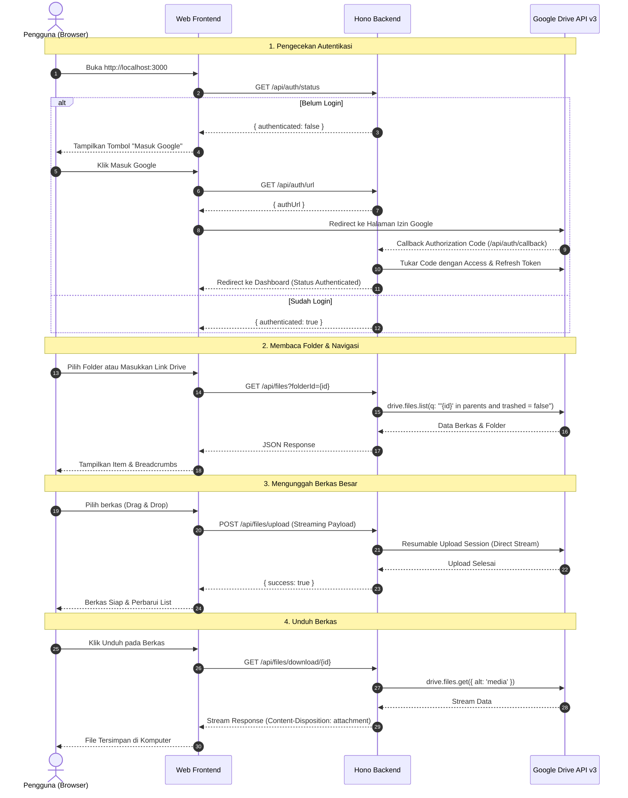

# 📂 Personal Drive Dashboard

<p align="center">
  
  
  
  
  
</p>

<p align="center">
  Aplikasi web lokal modern berkinerja tinggi untuk mengelola, menjelajah, mengunggah, dan mengunduh berkas <b>Google Drive</b> langsung dari komputer Anda tanpa overhead aplikasi berat.
</p>

---

## 📑 Daftar Isi

- [Tentang Proyek](#-tentang-proyek)
- [Fitur Utama](#-fitur-utama)
- [Teknologi yang Digunakan](#-teknologi-yang-digunakan)
- [Struktur Folder](#-struktur-folder)
- [Daftar Endpoint API](#-daftar-endpoint-api)
- [Alur Kerja Sistem](#-alur-kerja-sistem)
- [Panduan Memulai](#-panduan-memulai)
  - [Prasyarat](#1-prasyarat)
  - [Konfigurasi Google Cloud Console](#2-konfigurasi-google-cloud-console)
  - [Konfigurasi Environment](#3-konfigurasi-environment)
  - [Jalankan Aplikasi](#4-jalankan-aplikasi)
- [Dokumentasi Lanjutan](#-dokumentasi-lanjutan)

---

## 💡 Tentang Proyek

**Personal Drive Dashboard** adalah antarmuka web mandiri (*self-hosted client*) berbasis **Bun** dan framework **Hono**. Proyek ini dirancang agar pengguna dapat mengakses dan mengelola folder Google Drive dengan cepat, bersih, dan hemat sumber daya.

> [!NOTE]
> Proyek ini menggunakan **Zero-Build Frontend** (Vanilla HTML5, Modern CSS, dan ES Modules) serta memanfaatkan streaming biner langsung (*zero-disk buffering*), sehingga berkas besar seperti video atau arsip dapat ditransfer tanpa membebani disk lokal.

---

## ✨ Fitur Utama

- 🔐 **Autentikasi Aman**: Mendukung integrasi **Google OAuth 2.0** dan **Service Account**. Sesi token tersimpan otomatis di sisi lokal (`.tokens.json`) dengan mekanisme *auto-refresh token*.
- 📁 **File & Folder Explorer**: Navigasi struktur folder bertingkat dilengkapi *breadcrumb*, indikator tipe berkas, ukuran, dan tanggal pembaruan terakhir.
- 🔗 **Resolve Link Folder**: Buka folder spesifik mana pun secara instan hanya dengan menempelkan tautan (*URL link*) Google Drive.
- 🚀 **Upload Berkas Skala Besar (Hingga 20 GB)**: Menggunakan protokol *Google Resumable Upload* dengan *binary streaming* langsung untuk mengunggah file besar tanpa batasan memori.
- ⚡ **Direct Stream Download**: Mengunduh berkas langsung dari Google Drive API ke peramban tanpa membuat *cache* sementara di server lokal.
- 🔍 **Pencarian Cepat**: Cari berkas dan folder berdasarkan nama dengan pintasan keyboard `Ctrl + K`.
- 👁️ **Pratinjau Berkas (Quick Preview)**: Pratinjau langsung di peramban untuk gambar, dokumen, teks, audio, dan video.
- 📊 **Monitoring Kuota Storage**: Menampilkan kapasitas penyimpanan Google Drive yang terpakai, total kuota, dan sisa ruang secara *real-time*.
- 📝 **Live Activity Logger**: Panel log interaktif dan toast notifikasi untuk memantau status setiap operasi dan *error reporting*.

---

## 🛠️ Teknologi yang Digunakan

| Komponen | Teknologi | Keterangan |
| :--- | :--- | :--- |
| **Runtime & Package Manager** | [Bun](https://bun.sh/) (`>= v1.0`) | Runtime JavaScript/TypeScript performa tinggi dan cepat |
| **Backend Framework** | [Hono](https://hono.dev/) (`^4.13.16`) | Web framework modern, ringan, dan modular |
| **Google Client Library** | [googleapis](https://github.com/googleapis/google-api-nodejs-client) (`^189.0.0`) | SDK resmi Google untuk interaksi dengan Google Drive API v3 |
| **Bahasa Pemrograman** | [TypeScript](https://www.typescriptlang.org/) | Type-safe backend logic |
| **Frontend UI** | HTML5, Modern CSS, Vanilla JS | Antarmuka responsif tanpa *build step* (*zero bundler overhead*) |
| **Ikon Antarmuka** | [Lucide Icons](https://lucide.dev/) | Kumpulan ikon SVG modern via CDN |

---

## 📂 Struktur Folder

Susunan direktori proyek disesuaikan secara akurat dengan isi repositori:

```text
message/
├── public/                       # Frontend Web UI (Disajikan statis oleh Hono)
│   ├── css/
│   │   └── style.css             # Gaya antarmuka modern & responsif (Clean Dark/Light Theme)
│   ├── js/
│   │   ├── api.js                # Klien HTTP (Fetch wrapper) untuk komunikasi ke backend
│   │   ├── drive.js              # Logika file explorer, breadcrumbs, navigasi, & render list
│   │   ├── logger.js             # Utilitas log aktivitas UI dan status toast notification
│   │   ├── preview.js            # Modal pratinjau berkas (gambar, media, teks/dokumen)
│   │   └── upload.js             # Handler upload berkas besar & drag-and-drop
│   └── index.html                # Halaman utama aplikasi (Single Page Application)
├── src/                          # Backend Source Code (Bun + Hono)
│   ├── config/
│   │   └── google.ts             # Inisialisasi Google Auth Client, OAuth2, & token store
│   ├── routes/
│   │   ├── auth.route.ts         # Endpoint URL OAuth2 consent, callback, & cek status
│   │   ├── drive.route.ts        # Endpoint informasi akun & kapasitas kuota penyimpanan
│   │   └── files.route.ts        # Endpoint CRUD berkas: list, resolve link, upload, download, & trash
│   ├── services/
│   │   └── drive.service.ts      # Logika interaksi Google Drive API v3 & resumable stream uploader
│   └── index.ts                  # Entry point server Hono, CORS, konfigurasi port, & static file serve
├── .env.example                  # Template variabel lingkungan
├── .gitignore                    # Berkas dan folder yang diabaikan oleh Git
├── bun.lock                      # Lockfile dependensi Bun
├── package.json                  # Konfigurasi dependensi dan skrip proyek
├── README.developer.md           # Panduan teknis mendalam khusus pengembang
├── README.md                     # Dokumentasi utama proyek
└── tsconfig.json                 # Konfigurasi compiler TypeScript
```

---

## 📡 Daftar Endpoint API

Semua rute backend disajikan di bawah prefix rute `/api`:

### 1. Autentikasi (`/api/auth`)

| Method | Endpoint | Keterangan |
| :--- | :--- | :--- |
| `GET` | `/api/auth/status` | Mengecek status apakah server sudah terautentikasi ke Google Drive |
| `GET` | `/api/auth/url` | Mendapatkan URL consent Google OAuth 2.0 untuk login |
| `GET` | `/api/auth/callback` | Callback penerima kode otorisasi dari Google untuk ditukar dengan token |
| `POST` | `/api/auth/logout` | Menghapus sesi token lokal dan memutuskan sambungan |

### 2. Pengelolaan Berkas & Folder (`/api/files`)

| Method | Endpoint | Body / Query | Keterangan |
| :--- | :--- | :--- | :--- |
| `GET` | `/api/files` | `folderId` *(opsional)*, `search` *(opsional)* | Mengambil daftar berkas dan folder di dalam direktori tertentu |
| `POST` | `/api/files/resolve-link` | `{ "link": "https://drive.google.com/..." }` | Mengurai tautan URL Google Drive menjadi Folder ID yang valid |
| `POST` | `/api/files/folder` | `{ "name": "Nama Folder", "parentId": "root" }` | Membuat folder baru di direktori tujuan |
| `POST` | `/api/files/upload` | Binary stream via header (`x-file-name`, `x-folder-id`) atau Multipart | Mengunggah berkas besar dengan dukungan streaming langsung |
| `GET` | `/api/files/download/:id` | `:id` (ID berkas di Google Drive) | Mengunduh berkas secara direct stream ke peramban |
| `DELETE` | `/api/files/:id` | `:id` (ID berkas / folder) | Memindahkan berkas atau folder ke Tempat Sampah (*Trash*) |

### 3. Informasi Drive & Kuota (`/api/drive`)

| Method | Endpoint | Keterangan |
| :--- | :--- | :--- |
| `GET` | `/api/drive/about` | Mengambil data profil pengguna serta kuota penyimpanan (*total, used, remaining*) |

---

## 🔄 Alur Kerja Sistem



---

## 🚀 Panduan Memulai

### 1. Prasyarat
Pastikan Anda telah memasang runtime **Bun** pada komputer Anda:
```bash
# Cek instalasi Bun
bun --version
```
Jika belum memiliki Bun, pasang melalui terminal:
- **Windows (PowerShell)**: `powershell -c "irm bun.sh/install.ps1 | iex"`
- **Linux & macOS**: `curl -fsSL https://bun.sh/install | bash`

---

### 2. Konfigurasi Google Cloud Console

1. Buka [Google Cloud Console](https://console.cloud.google.com/).
2. Buat proyek baru atau pilih proyek yang sudah ada.
3. Masuk ke menu **APIs & Services > Library**, cari **Google Drive API**, lalu klik **Enable**.
4. Buka menu **APIs & Services > OAuth consent screen**:
   - Pilih jenis pengguna **External**.
   - Isi nama aplikasi dan email dukungan.
   - Tambahkan *Scope*: `.../auth/drive` (akses penuh untuk membaca, mengunggah, dan menghapus berkas).
   - Masukkan email Google Anda pada bagian **Test Users**.
5. Buka menu **APIs & Services > Credentials**:
   - Klik **Create Credentials > OAuth client ID**.
   - Pilih Application type: **Web application**.
   - Pada kolom **Authorized redirect URIs**, tambahkan:
     ```text
     http://localhost:3000/api/auth/callback
     ```
   - Simpan dan salin **Client ID** serta **Client Secret** Anda.

---

### 3. Konfigurasi Environment

Salin file contoh `.env.example` menjadi `.env`:

```bash
cp .env.example .env
```

Buka file `.env` lalu sesuaikan isinya:

```env
# Port Server Lokal
PORT=3000

# Mode Autentikasi Google: 'oauth' atau 'service_account'
GOOGLE_AUTH_MODE=oauth

# Konfigurasi Google OAuth 2.0 (dari Google Cloud Console)
GOOGLE_CLIENT_ID=isi_dengan_client_id_anda.apps.googleusercontent.com
GOOGLE_CLIENT_SECRET=isi_dengan_client_secret_anda
GOOGLE_REDIRECT_URI=http://localhost:3000/api/auth/callback

# Token Penyimpanan (Otomatis terisi saat login OAuth pertama kali)
GOOGLE_REFRESH_TOKEN=

# Opsional: Jika menggunakan Service Account
GOOGLE_SERVICE_ACCOUNT_KEY_PATH=./credentials.json
```

---

### 4. Jalankan Aplikasi

1. Pasang dependensi proyek:
   ```bash
   bun install
   ```

2. Jalankan server dalam mode pengembangan (*hot-reload*):
   ```bash
   bun run dev
   ```

3. Buka peramban Anda dan kunjungi:
   ```text
   http://localhost:3000
   ```

---

## 📖 Dokumentasi Lanjutan

Bagi pengembang yang ingin mempelajari detail internal arsitektur streaming, penanganan token OAuth2, atau mekanisme resumable upload:
👉 Baca selengkapnya di [README.developer.md](./README.developer.md).

---

## 📄 Lisensi

Proyek ini dibuat untuk keperluan magang & pengembangan pribadi. Silakan gunakan dan kembangkan sesuai kebutuhan Anda.
